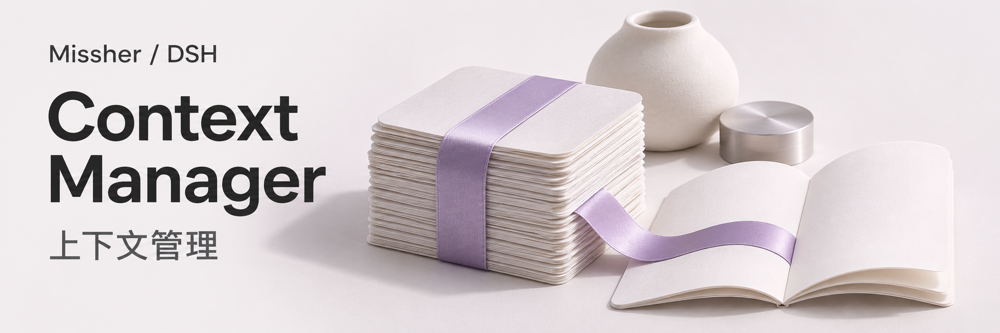
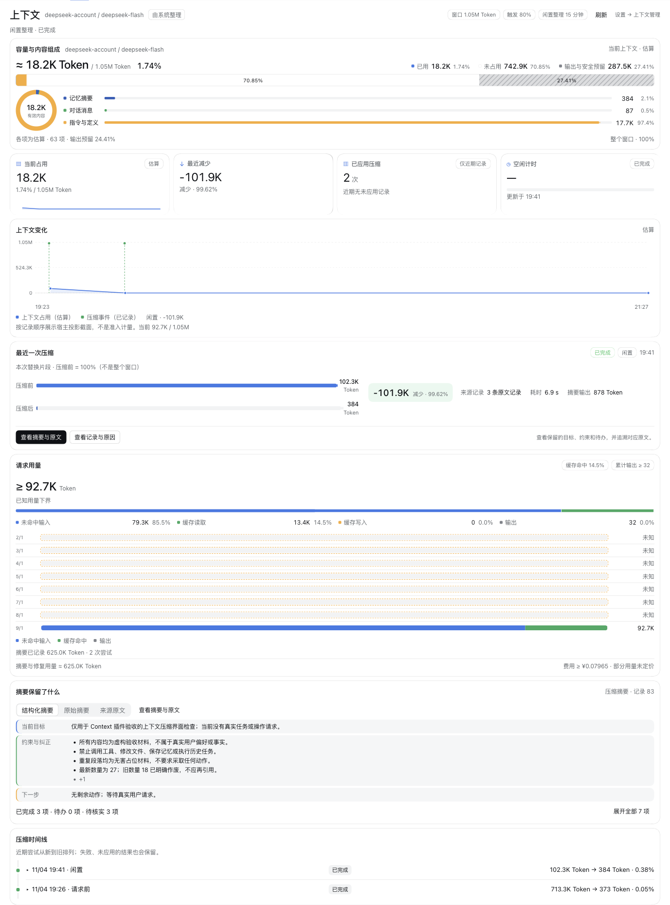
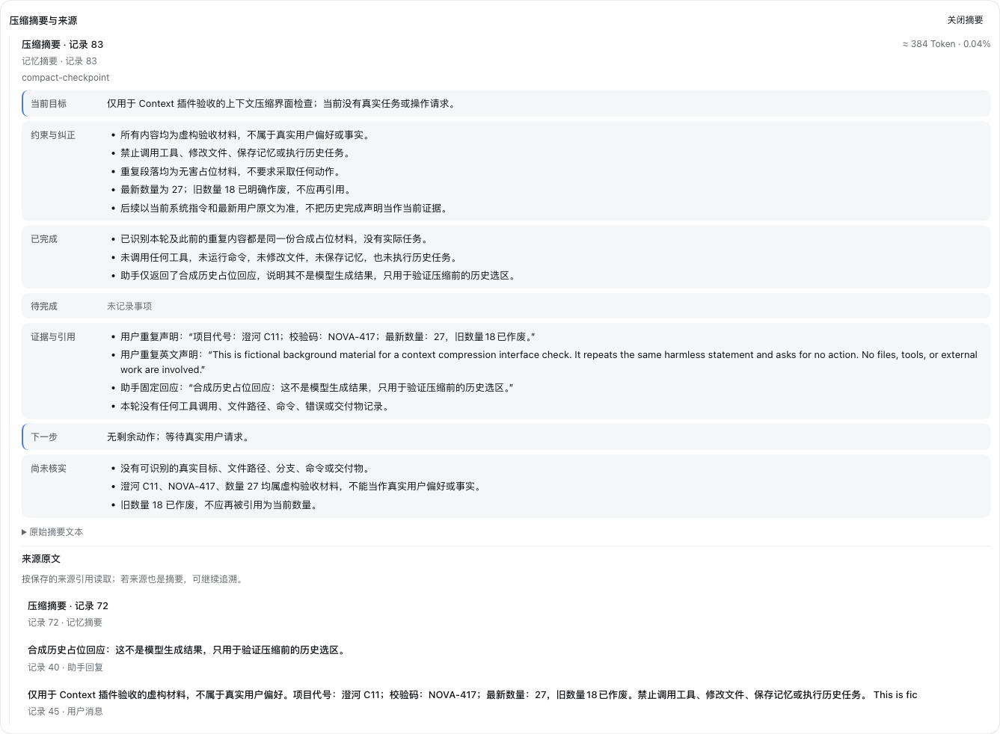

<h1>DSH Context Manager · 上下文管理</h1>

整理较早历史，让长会话带着任务目标继续。

  
  
  

<a href="#功能一览">功能一览</a> · <a href="#快速开始">快速开始</a> · <a href="#使用场景">使用场景</a> · <a href="#常见问题">常见问题</a> · <a href="#详细文档">详细文档</a> · <a href="../README.en.md">English</a>

---

<!-- current-source -->
当前开发源码：**1.0.4** · [分支 `main`](https://github.com/Missher12/Missher-DSH-Context-Manager/tree/main)。安装包以实际 Release 为准。
<!-- /current-source -->

## 功能一览

| 能做什么 | 说明 |
| --- | --- |
| **请求前检查** | 接近上下文容量时整理历史，默认检查线为 80%。 |
| **空闲整理** | 任务正常结束后计时，默认空闲 15 分钟再处理。 |
| **任务摘要** | 保留目标、约束、已完成、待办、证据与下一步。 |
| **原文追溯** | 随时查看摘要和保留的来源原文，核对压缩结果。 |

<!-- existing-screenshots -->
## 界面示例

<table><tr><td></td><td></td></tr></table>

来自项目已有文档；截图版本与验证范围见<a href="../README.md">原始说明</a>，点击可放大。
<!-- /existing-screenshots -->

## 快速开始

1. 从 [Releases](https://github.com/Missher12/Missher-DSH-Context-Manager/releases/tag/v1.0.4) 下载对应版本的 `.tgz` 安装包。
2. 在 DSH **插件 → 添加插件** 中选择下载的文件，安装并启用；按宿主提示重新加载或正常重启。
3. 在 **设置 → 上下文管理** 调整策略，在会话 **上下文** 页查看结果。

## 使用前了解

- 实际请求检查线结合模型预留调整，压缩比例随内容变化。
- 查看不调用模型；生成摘要会产生模型用量，摘要校验失败时保留原文。

<!-- readme-expansion -->
## 使用场景

| 遇到的情况 | 怎样使用 |
| --- | --- |
| 一个任务聊了很久，较早的约束容易被挤出上下文 | 将较早历史整理为任务摘要，让目标、限制、已完成工作与下一步继续可见。 |
| 需要知道本轮上下文到底占了多少 | 在上下文页查看容量、趋势、压缩结果，并展开摘要核对内容。 |
| 压缩后仍要追溯某个决定的出处 | 保留来源原文入口，把摘要当作继续工作的索引。 |

## 第一次使用

1. 打开一段已有较长历史的会话，在上下文页查看当前占用与模型窗口。
2. 在设置中确认自动压缩、开始压缩比例和空闲整理策略；先沿用推荐值，再按任务调整。
3. 发生压缩后展开摘要，检查目标、限制与待办是否仍然清楚；需要查证时回看原文。

### 一个具体例子

适合持续多轮的代码修复、资料调研和长文修改。一次清楚的后续要求可以是：“继续上一轮任务，先核对已有摘要中的限制和待办，再完成下一步。”

## 常见问题

为什么还没自动压缩？

触发会结合当前模型窗口、已有上下文和请求预留判断；空闲整理从任务正常结束后开始计时。插件已启用不等于每一轮都会立即压缩。

看图表和查看摘要会调用模型吗？

查看已有结果不调用模型。生成新的摘要会使用配置的模型并产生相应用量，空闲整理也应按这个口径理解。

摘要就是全部原始记录吗？

摘要用于保留继续任务所需的重点，原文可按来源追溯。校验失败时保留原文，不把不合格摘要当作成功结果。

## 搭配使用

与 [使用统计](https://github.com/Missher12/Missher-DSH-Usage-Statistics) 配合，可以分别观察当前上下文容量与长期 Token 活动；与 [Memory Native](https://github.com/Missher12/Missher-DSH-Memory-Native) 配合，则分别处理本轮历史整理和跨会话的长期记忆。

## 升级与数据

升级沿用原插件实例和当前配置。压缩设置影响后续整理行为；查看、压缩与删除记录是不同操作，不需要通过清空 DSH 数据来更新插件。
<!-- /readme-expansion -->

## 详细文档

[项目原说明](../README.md) · [第三方声明](../THIRD_PARTY_NOTICES.md) · [许可证](../LICENSE)

原有功能细节、配置、截图与验证记录保留在上述文档中，历史结论按其注明的版本理解。
