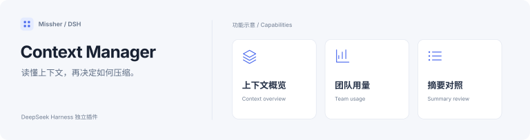

<h1>DSH Context Manager · 上下文管理</h1>

整理较早历史，让长会话带着任务目标继续。

  
  
  

<a href="#功能一览">功能一览</a> · <a href="#快速开始">快速开始</a> · <a href="#详细文档">详细文档</a> · <a href="../README.en.md">English</a>

---

<!-- current-source -->
当前开发源码：**1.0.2** · [分支 `main`](https://github.com/Missher12/Missher-DSH-Context-Manager/tree/main)。安装包以实际 Release 为准。
<!-- /current-source -->

## 功能一览

| 能做什么 | 说明 |
| --- | --- |
| **请求前检查** | 接近上下文容量时整理历史，默认检查线为 80%。 |
| **空闲整理** | 任务正常结束后计时，默认空闲 15 分钟再处理。 |
| **任务摘要** | 保留目标、约束、已完成、待办、证据与下一步。 |
| **原文追溯** | 随时查看摘要和保留的来源原文，核对压缩结果。 |

<!-- existing-screenshots -->
## 界面示例

<table><tr><td></td><td></td></tr></table>

来自项目已有文档；截图版本与验证范围见<a href="../README.md">原始说明</a>，点击可放大。
<!-- /existing-screenshots -->

## 快速开始

1. 从 [Releases](https://github.com/Missher12/Missher-DSH-Context-Manager/releases/tag/v1.0.3) 下载对应版本的 `.tgz` 安装包。
2. 在 DSH **插件 → 添加插件** 中选择下载的文件，安装并启用；按宿主提示重新加载或正常重启。
3. 在 **设置 → 上下文管理** 调整策略，在会话 **上下文** 页查看结果。

## 使用前了解

- 实际请求检查线结合模型预留调整，压缩比例随内容变化。
- 查看不调用模型；生成摘要会产生模型用量，摘要校验失败时保留原文。

## 详细文档

[项目原说明](../README.md) · [第三方声明](../THIRD_PARTY_NOTICES.md) · [许可证](../LICENSE)

原有功能细节、配置、截图与验证记录保留在上述文档中，历史结论按其注明的版本理解。
