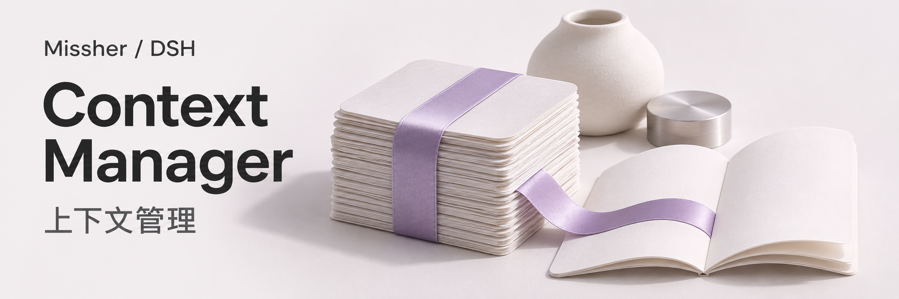
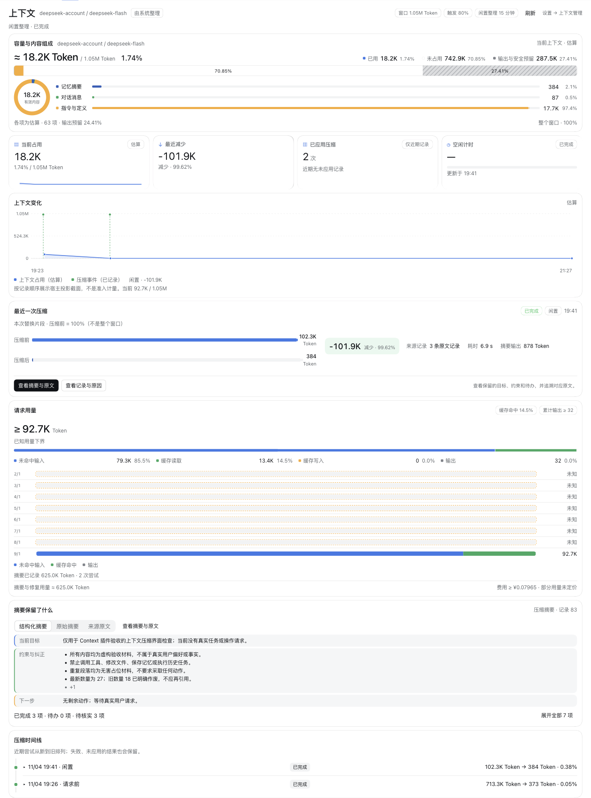
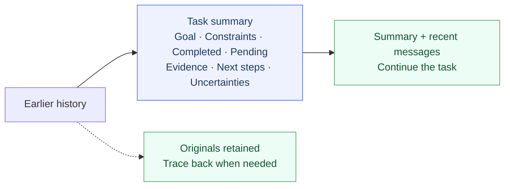
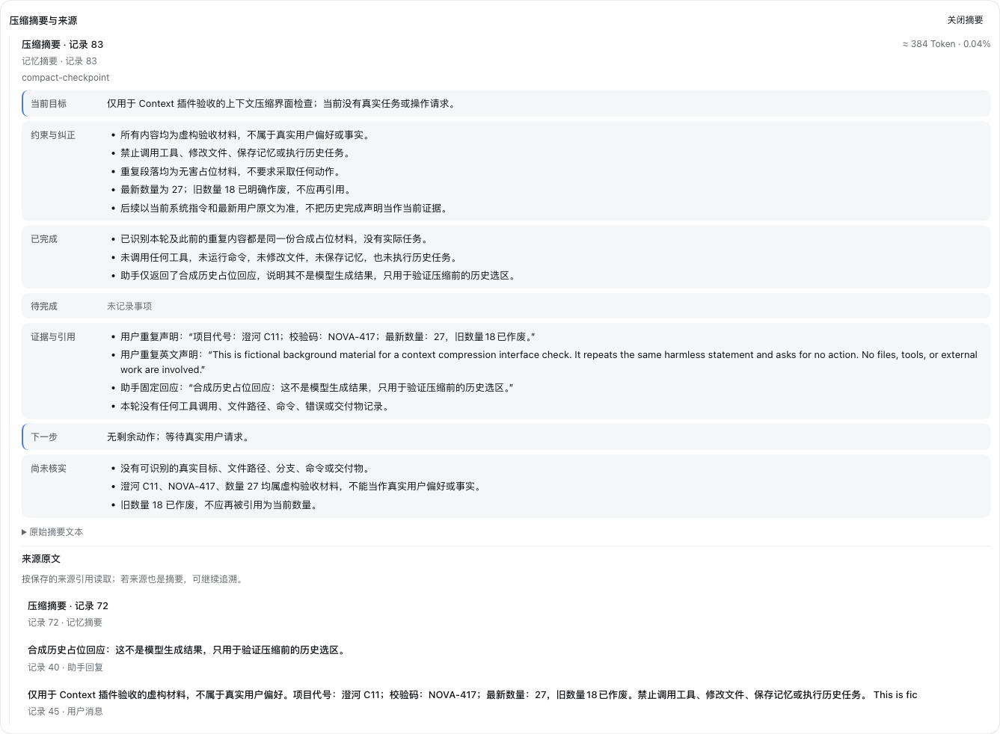

# Missher DSH Context Manager



**Quality compaction that keeps long conversations moving.**

[中文](./README.md) · English · [Download / Releases](https://github.com/Missher12/Missher-DSH-Context-Manager/releases) · [Feedback](https://github.com/Missher12/Missher-DSH-Context-Manager/issues)



<sub>Local app screenshot with fictional acceptance material, shown in Chinese. Capacity, trends, compaction results and summary in one view. Reduction varies with content.</sub>

| Pre-request check | Idle after completion | Inspect anytime |
| :---: | :---: | :---: |
| **80%** by default | **15 minutes** by default | **Summary + original sources** |

Idle timing starts after normal task completion. The effective request threshold also accounts for model reservations.

## What survives compaction



<details>
<summary><strong>See the summary and original-source view</strong></summary>



</details>

Viewing makes no model calls. Generating a summary incurs model usage; failed validation leaves the original history intact.

## Start in three steps

1. Download a `.tgz` from [Releases](https://github.com/Missher12/Missher-DSH-Context-Manager/releases).
2. Install and enable it in **DSH's plugin manager**. Let running tasks finish before restarting as prompted.
3. Adjust the policy in **Settings → Context Manager** and inspect results in the session's **Context** view.

<details>
<summary>Build from source</summary>

Use standard Node.js 24 and the pnpm version specified in `package.json`.

```sh
pnpm install --frozen-lockfile
pnpm run typecheck
pnpm run build
pnpm test
pnpm pack
```

</details>

[MIT](./LICENSE) · [Third-party notices](./THIRD_PARTY_NOTICES.md)

[](https://github.com/deepseek-ai/deepseek-harness)
