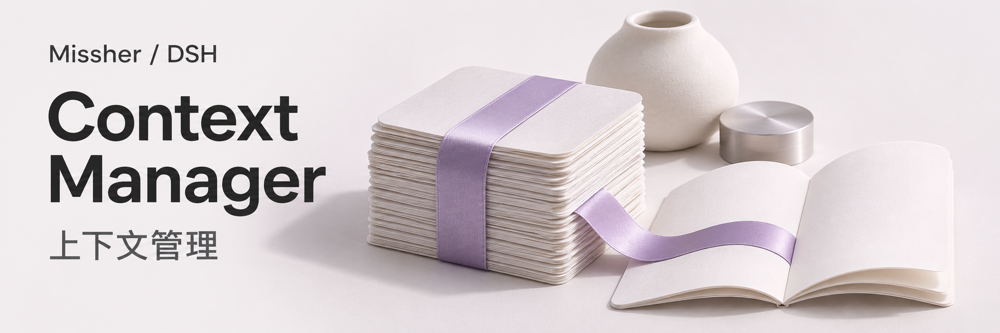
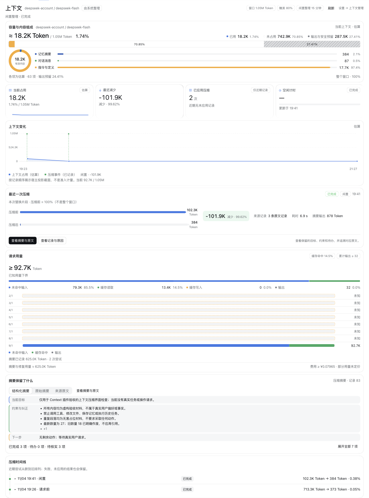
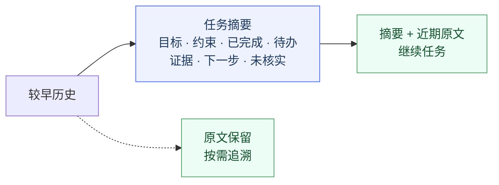
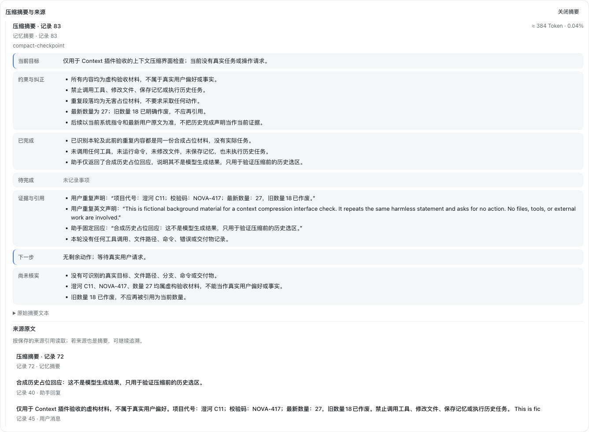

# Missher DSH Context Manager



当前版本 **1.0.5** · [同版安装包](https://github.com/Missher12/Missher-DSH-Context-Manager/releases/tag/v1.0.5)
**高质量压缩，让长会话继续任务。**

中文 · [English](./README.en.md) · [下载 / Release](https://github.com/Missher12/Missher-DSH-Context-Manager/releases) · [反馈](https://github.com/Missher12/Missher-DSH-Context-Manager/issues)



<sub>本机实拍，使用虚构验收材料。容量、趋势、压缩结果与摘要一页可见；压缩比例随内容而变。</sub>

| 请求前检查 | 任务后空闲整理 | 随时回看 |
| :---: | :---: | :---: |
| 默认 **80%** | 默认 **15 分钟** | **摘要 + 来源原文** |

空闲从任务正常结束后计时；实际请求检查线会结合模型预留调整。
可按提供方和模型分别设置上下文上限，限制该路由的可用上下文与压缩预算。

## 压缩后保留什么



<details>
<summary><strong>展开看：摘要与原文界面</strong></summary>



</details>

查看不调用模型；生成摘要会产生模型用量。摘要校验失败时保留原文。

## 三步开始

1. 从 [Releases](https://github.com/Missher12/Missher-DSH-Context-Manager/releases) 下载 `.tgz`。
2. 在 **DSH 插件管理** 中安装并启用，等任务结束后按提示重启。
3. 在 **设置 → 上下文管理** 调整策略，在会话的 **上下文** 页查看结果。

<details>
<summary>从源码构建</summary>

使用标准 Node.js 24 和 `package.json` 指定的 pnpm。

```sh
pnpm install --frozen-lockfile
pnpm run typecheck
pnpm run build
pnpm test
pnpm pack
```

</details>

[MIT](./LICENSE) · [第三方声明](./THIRD_PARTY_NOTICES.md)

[](https://github.com/deepseek-ai/deepseek-harness)
